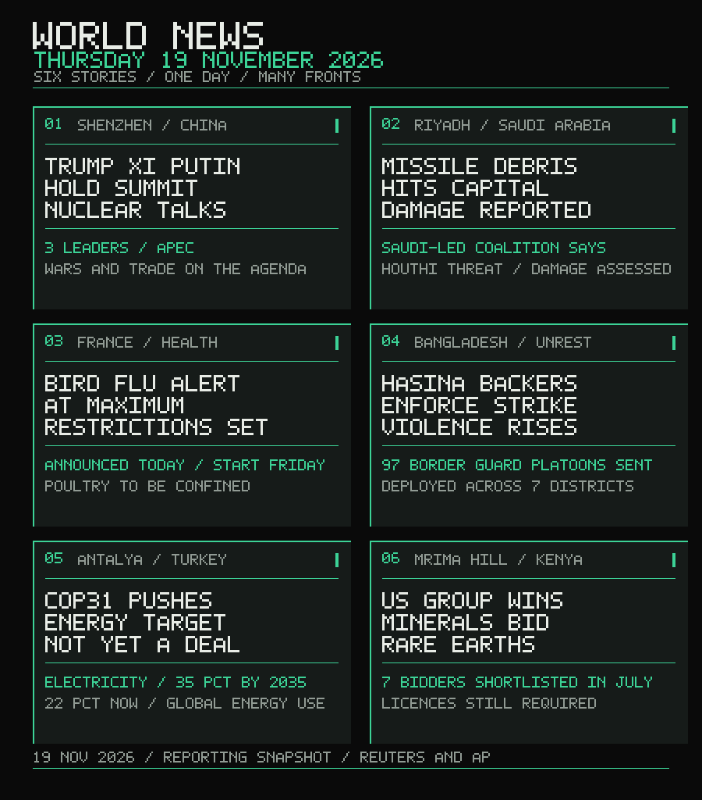

# World news / 19 November 2026

[](https://make.fun/bounty/news-image-20261119)
[](https://make.fun/bounty/news-image-20261119/leaderboard)
[](https://make.fun/bounty/news-image-20261119)

Six sourced dispatches: diplomacy, conflict, health, unrest, climate and critical minerals. A deterministic 900 by 1024 PNG, drawn entirely in TypeScript with a handmade monospace pixel alphabet, flat geometric marks and a standard-library PNG encoder. No external fonts, photographs, images, packages or network calls.



## Run

Node 22 or later:

```sh
mkdir -p out
MAKEFUN_OUTPUT_DIR=out node main.ts
```

The competition defaults to `/output/entry.png`. The committed preview is generated by exactly this program. All numbers in the poster are attributed and explained in [SOURCES.md](SOURCES.md). This is a reporting snapshot, not a claim that six items exhaust the day's news.

## Editorial choices

The largest power summit leads, followed by the Saudi coalition's reported missile damage. Health and political unrest add distinct beats; climate negotiations and Kenya's critical-minerals selection widen the selection. The electricity proposal is explicitly not a concluded agreement; Kenya's selection is not a mining licence. No damage estimate is invented for Riyadh, and no unsupported case count is assigned to France.

MIT licensed. Built for [make.fun](https://make.fun/bounty/news-image-20261119).
